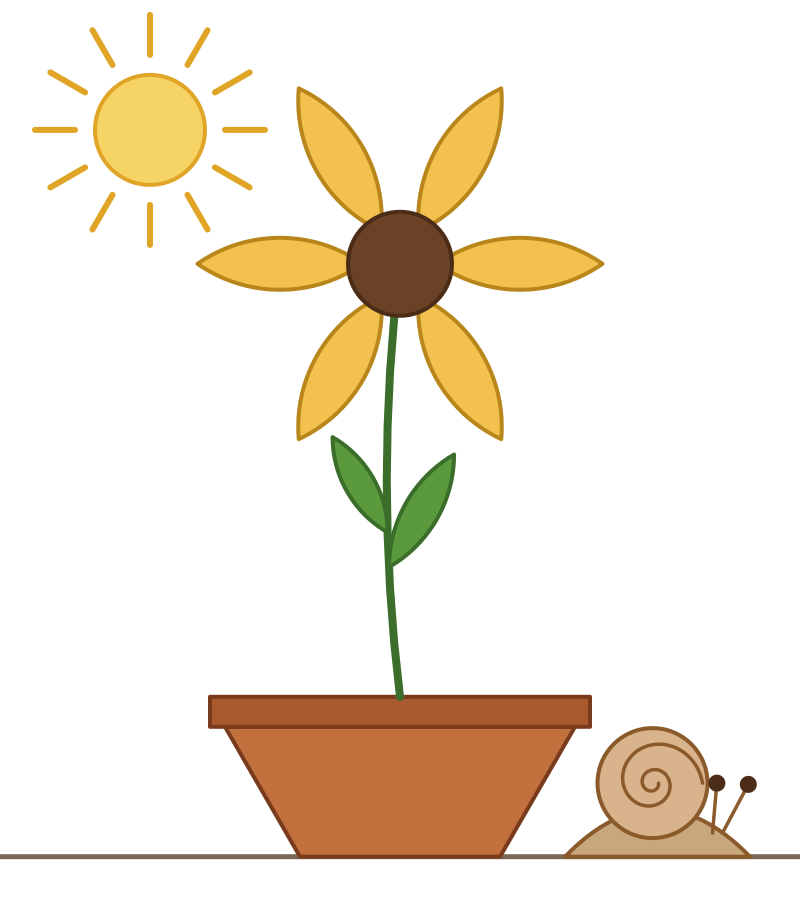

# Tzel

Tzel is a drawing language built for an author who can't see the canvas. You draw on a lattice with geometric moves (angles, lengths, arcs, spirals) instead of raw coordinates. Every term marks its own role, so terms can come in any order. You can stop at any point and ask what you've drawn, and the answers come back as text.

This is v0: a thin 2D slice in Python, made to find out how far an AI can get drawing this way.



`examples/garden.tz` is the session that drew the picture above. It still contains every question asked along the way.

## Quick start

```
pip install pillow cairosvg      # cairosvg is only needed for PNG output
python -m tzel run examples/garden.tz --png
python -m tzel repl
```

`run` prints the renderer's feedback (lines starting `«`, tagged with source line numbers) and writes an `.svg` next to the source file. Add `--png` to also write a PNG, or `--from N` to show only the feedback from line N onward. That flag is useful when you append to a file and re-run it.

On Windows, `cairosvg` needs the Cairo DLL. If it can't load, PNG output falls back to Playwright (`pip install playwright && playwright install chromium`). SVG output needs neither.

## The language in one page

### Setup

```
canvas 16x18               # size in lattice units
lattice hex                # grid | hex (6 neighbors at 60°)
origin canvas.bottom       # where lattice (0,0) sits
mode snap lattice          # any number of modes; see below
```

### Points

| Form | Meaning |
| --- | --- |
| `(3,-1)` | Coordinates on the current lattice (decimals are fine) |
| `hex(3,-1)`, `grid(2,5)` | Coordinates on a named lattice |
| `stem.end`, `pot.top`, `stem.at(0.3)` | Anchors on named shapes |
| `canvas.top-left`, `origin`, `here` | Canvas anchors, the lattice origin, and the pen |
| `stem.end→NE×2`, `pot.top+(1,0)` | Any point, then steps or a lattice offset |

Shape anchors are `start`, `end`, `at(t)`, `center`, `centroid`, `top`, `bottom`, `left`, `right`, `top-left` and similar corners, plus any named segment (`leaf.upper`).

### Moves and their markers

A path is a list of moves separated by `;` or indented continuation lines. Each move is an unordered bag of marked terms:

| Role | Glyph | Word form | Example |
| --- | --- | --- | --- |
| Endpoint | `@` | `to:` | `@hex(3,1)` |
| Direction steps | `→` or `->` | `toward:` | `→NE×2` |
| Heading | `∠` | `angle:` | `∠30°` |
| Length | `⟷` or `<->` | `len:` | `⟷3` |
| Sweep (CCW +) | `⌒` or `~` | `sweep:` | `⌒90°` |
| Pole | `⊙` | `pole:` | `⊙sun` |
| Segment name | `as` | | `as upper` |
| Start point | `from` | | `from stem.at(0.4)` |

The move kind is `line`, `arc`, `quad` or `geo`. If you don't name one, Tzel infers it: a sweep implies `arc`, a pole or `wind` implies `geo`, and `ctrl` or `peak` implies `quad`. Other terms: `wind 2`, `peak 1.5`, `ctrl P`, `r:1`, `cw`, `close`.

These three lines are the same move:

```
arc ⌒90° →NE as bend
as bend →NE arc ⌒90°
→NE ⌒90° as bend arc
```

How the four kinds work:

- **line:** goes to an endpoint, or along a heading and length.
- **arc:** with an endpoint, it uses the sweep, or solves the sweep from an arclength. With neither, it continues tangent to the previous move (`fill-in smoothest`). Without an endpoint, it needs a sweep plus a length or `r:`.
- **quad:** a quadratic curve to an endpoint, using `ctrl P` or `peak h`, or tangent to the previous heading.
- **geo:** a log-space interpolation around a pole, which draws logarithmic spirals. `wind n` adds full turns.

If you give more terms than a move needs, the extras are checked. A disagreement is reported (`mode mismatch warn|error|trust`) rather than silently ignored.

### Shapes and styles

```
bud:   circle r:1 sitting-on stem.end fill:#e8a0b4
rim:   rect w:7.6 h:0.6 sitting-on pot.top
label: text "Morning" below hill gap 0.5 size:0.8
eye:   dot at stalk.end r:0.13
sc:    point at (4.5,2.7)          # invisible, just an anchor
```

Placement terms are `at`, `sitting-on`, and `below`, `above`, `left-of` or `right-of` (each with an optional `gap`). Styles are `stroke:`, `fill:`, `width:`, `opacity:`, `dash:` and `layer:back|mid|front|<n>`. To restyle later, write `style petals fill:#f5c2c7`.

### Transforms, groups, copies

```
turn leaf 30                  # around its own center
scale petals 1.5              # groups too
move snail →W×0.8             # or: move x @point, move x +(1,0)
mirror leaf2 across stem      # or: mirror x / mirror x horizontal
turn leaf 20 around stem.end  # around an outside point
repeat petal 6 around stem.end as petals
copy leaf as leaf2
group snail: body, shell, spiral, eye
group recent: last 3..1
del leaf2                     # the eraser
```

A transform around a shape's own center replaces any earlier transform of the same kind (restating `turn leaf 45` replaces the earlier turn), and the different kinds commute. A transform around an outside point (`around P`, `mirror … across …`) is order-sensitive, so everything before it is baked in and statements apply in the order written.

### Revising

A restated term replaces the earlier one, and the whole drawing replays, so anything anchored to the revised shape follows it:

```
stem @rim.top→NE×5→NW×5       # stem gets taller; the flower head moves up with it
body.1 peak 0.95              # revise one move of a path by number or name
```

### Modes

| Mode | Values | Default |
| --- | --- | --- |
| `snap` | off, lattice, half | off |
| `pole` | origin, any anchor | origin |
| `fill-in` | smoothest, simplest | smoothest |
| `mismatch` | warn, error, trust | warn |
| `feedback` | quiet, push, verbose | push |
| `stroke`, `width`, `fill` | defaults for new shapes | #222222, 0.08, none |
| `show-lattice` | off, on | off |

### Queries

| Query | Answers |
| --- | --- |
| `?describe x` | Shape, size, convexity, corners, symmetry, position, and relations to neighbors |
| `?try <statement>` | What would happen, without committing |
| `?here` | Pen position, heading, and what's nearby |
| `?size x`, `?gap a b` | Measurements (groups work too) |
| `?crosses x`, `?closed x` | Relations |
| `?where stem.end`, `?on hex leaf` | Coordinates, including on another lattice |
| `?balance`, `?symmetry x` | Composition |
| `?names`, `?overview`, `?modes` | Inventory |
| `?glance [landmark]` | Four 32×32 views tiled into one 66×66 PNG, plus a 4× copy |
| `?render [file]` | A full PNG |

Pushed notes arrive without asking: unexpected crossings, a shape leaving the canvas, snapping, and mismatches.

### Assertions

```
assert inside canvas petals
assert no-overlap leaf petals
assert gap leaf2 petals >= 0.3
```

## Known gaps in v0

- Relations (`below`, `sitting-on`) are resolved once, when the statement runs. A later transform of the reference shape won't move the dependent one, but a *revision* will, because revisions replay everything.
- Names must be defined before they're used. Forward references aren't supported yet.
- Only the grid and hex lattices exist. There's no 3D, animation, or relational color yet.
- Crossing checks ignore occlusion, so a crossing hidden under a filled shape is still reported.
- Descriptions are computed from geometry only. The instruct-captioner tier isn't built yet.
